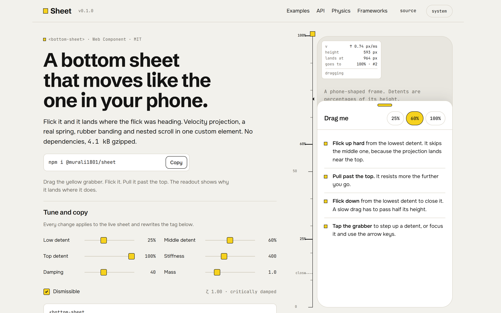

<picture>
  <source media="(prefers-color-scheme: dark)" srcset="docs/screenshot-dark.png">
  
</picture>

# Sheet

**A zero-dependency `<bottom-sheet>` Web Component that moves like the one in your phone.** Velocity projection, a real spring, rubber banding and nested scroll, in about 4.1 kB gzipped.

Live demo: https://sheet-murali.vercel.app. Try it on a phone.

## Quick start

```bash
npm i @murali1801/sheet   # not published yet
```

```html
<script type="module" src="https://esm.sh/@murali1801/sheet"></script>

<button onclick="document.querySelector('bottom-sheet').show()">Open</button>

<bottom-sheet modal dismissible snap="25% 60% 100%">
  <h2 slot="header">Filters</h2>
  <p>Any content. It scrolls when the sheet is at its top detent.</p>
  <button slot="footer">Apply</button>
</bottom-sheet>
```

Or from a bundler: `import '@murali1801/sheet'` once, then use the tag. A single self-contained file is at `@murali1801/sheet/min`.

## Features

- **Physics you can feel.** Release velocity from the last 100 ms of pointer samples, iOS-style projection (`d = 0.998`) to pick the detent, a semi-implicit spring seeded with that velocity, rubber banding past the limits.
- **Snap points** in `%`, `px` or fractions, with `snapTo(i)`, `initial` and a tunable `stiffness`, `damping` and `mass`.
- **Swipe to dismiss** by velocity or distance, plus Esc and scrim tap, all behind `dismissible`.
- **Nested scroll handoff**: content drags move the sheet until it is at the top detent, then the content scrolls. Pull down from the top of the content to bring the sheet back down.
- **Modal or not.** `modal` uses `<dialog>.showModal()` for the top layer, focus containment, Esc and an inert page. Without it, the page stays live (map style).
- **On-screen keyboard aware** through `visualViewport`: the sheet lifts above the keyboard and opens fully when a field inside has focus.
- **Sticky header and footer slots.** The footer rides the visible bottom edge at every detent.
- **Accessible grabber**: a real button. Tap or Enter steps up a detent, arrow keys move between detents.
- **Reduced motion** makes every snap instant. Animation writes transforms and opacity only.
- **Styling** through CSS custom properties and `::part(panel | handle | grip | scrim | header | content | footer)`.
- **Events**: `sheet-open`, `sheet-snap`, `sheet-drag` (with live velocity, projected landing and target detent), `sheet-close` (with the reason).

### API

| Attribute | Default | Meaning |
|---|---|---|
| `snap` | `50% 90%` | Detents, any order: `60%`, `320px`, bare px, or a fraction `0.6` |
| `open` | off | Present while open; add or remove it to open or close |
| `initial` | `0` | Detent index to open at |
| `stiffness` / `damping` / `mass` | `400` / `40` / `1` | Spring constants (the defaults are critically damped) |
| `dismissible` | off | Swipe down, Esc and scrim tap can close it |
| `modal` | off | Open with `showModal()`: scrim, top layer, inert page |
| `backdrop-from` | none | Detent index (or `60%`) where the scrim starts; full at the next detent |
| `label` | none | Accessible name for the dialog |

Methods: `show(index?)`, `close()`, `snapTo(i)`. Properties: `open`, `index`, `detents`.

CSS custom properties: `--sheet-bg`, `--sheet-color`, `--sheet-radius`, `--sheet-shadow`, `--sheet-scrim`, `--sheet-handle`, `--sheet-focus`, `--sheet-max-width` (640px), `--sheet-grip-height`, `--sheet-z`.

Add `data-no-drag` to any element that must never start a drag. Inputs, textareas and selects never do.

### Frameworks

It is a standard custom element, so it works as a plain tag in HTML, React 19, Vue 3 (mark `bottom-sheet` as a custom element in the template compiler options), Svelte 5 and Astro. The docs page has a snippet for each.

## Comparison

Star counts from the GitHub API on 2026-11-15.

| | Sheet | [Vaul](https://github.com/emilkowalski/vaul) | [pure-web-bottom-sheet](https://github.com/viliket/pure-web-bottom-sheet) | [react-modal-sheet](https://github.com/temzasse/react-modal-sheet) |
|---|---|---|---|---|
| Framework | Any (custom element) | React | Any (custom element) | React |
| How it moves | Spring seeded by release velocity; detent from projected landing | CSS transitions, velocity threshold | CSS scroll snap, detent decided by the browser | Springs from the Motion library |
| Tunable physics | `stiffness`, `damping`, `mass` | No | No | See its docs |
| Dependencies | 0 | React + Radix Dialog | 0 | React + Motion |
| Browser floor | Evergreen browsers with `<dialog>` | Follows React | Safari 18.2+ for full features | Follows React |
| Maintenance | New | README says unmaintained | Active | Active |
| Stars | new | 8,740 | 228 | 1,183 |

Vaul is still the feel benchmark and has features Sheet does not, like scaling the page behind. pure-web-bottom-sheet does SSR through declarative shadow DOM, which Sheet does not do yet.

## How it works

All the physics is in [`src/physics.ts`](src/physics.ts) as pure functions with unit tests (`npm test`).

1. **Velocity**: pointer events with capture; only samples from the last 100 ms count, so a finger that rests before lifting gives 0.
2. **Projection**: `lands = y + v * d / (1 - d)` with `d = 0.998` per ms, the deceleration of an iOS scroll view. A 1 px/ms flick travels 499 px. The sheet goes to the detent nearest the projected point, not the release point.
3. **Dismiss**: a downward flick over 0.5 px/ms from the lowest detent, or a projection that ends below half the lowest detent's height. Higher up, a moderate flick lands on a lower detent instead of closing everything, as in iOS and Vaul.
4. **Rubber band**: past a limit the offset is `(1 - 1 / (x * 0.55 / dim + 1)) * dim`.
5. **Spring**: semi-implicit Euler (velocity, then position) in 240 Hz sub-steps per animation frame, frames capped at 64 ms. Stiffness 400, damping 40, mass 1 is critically damped. The release velocity is the spring's starting velocity, so drag and animation join without a seam.
6. **Nested scroll**: below the top detent a content drag moves the sheet; at the top detent the content scrolls unless it is at `scrollTop` 0 and the finger moves down. A non-passive `touchmove` listener stops the browser scrolling while the sheet is being dragged.
7. **Layout**: detents are measured on open, resize and keyboard changes only. Each frame writes one transform for the panel, one for the sticky footer and the scrim's opacity.

## Development

```bash
npm install
npm run dev      # docs site on http://localhost:5173
npm test         # Vitest, physics module
npm run build    # library (dist/), types, docs site (site-dist/), size check
```

`npm run build` fails if `dist/bottom-sheet.min.js` goes over 6 kB gzipped. Current size: 4.05 kB gzip, 3.63 kB brotli.

## Contributing

Issues and pull requests are welcome. Keep it dependency-free, keep `npm test` and `npm run build` green, and add a physics test for any change to how the sheet moves. For feel changes, include a short phone recording.

## License

[MIT](LICENSE) © 2026 Muralidhar Acharya

---

Part of a set of tools by Murali: Tonal · Sheet · Tab · Masthead
